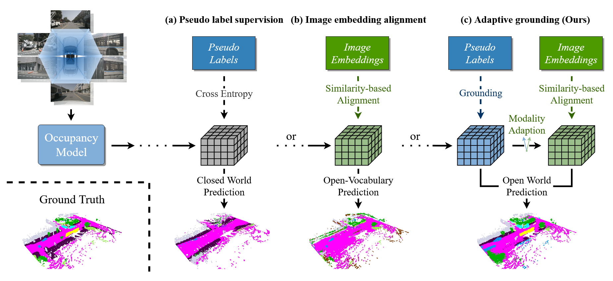
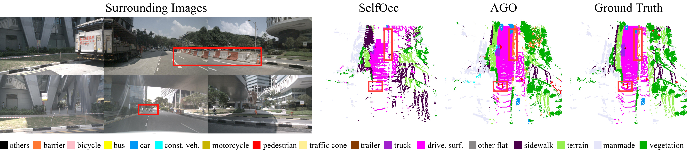
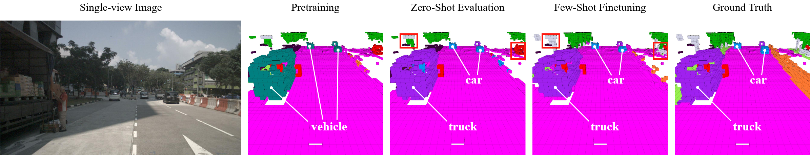

<div align="center">

# **AGO**: **A**daptive **G**rounding for **O**pen World 3D Occupancy Prediction

[**ICCV 2025**](https://openaccess.thecvf.com/content/ICCV2025/html/Li_AGO_Adaptive_Grounding_for_Open_World_3D_Occupancy_Prediction_ICCV_2025_paper.html)

[Peizheng Li](https://edwardleelpz.github.io/), [Shuxiao Ding](https://dsx0511.github.io/), [You Zhou](https://scholar.google.com/citations?user=DAuIVp8AAAAJ&hl=en), [Qingwen Zhang](https://kin-zhang.github.io/), [Onat Inak](https://openreview.net/profile?id=~Onat_Inak1), [Larissa Triess](https://larissa.triess.eu/), [Niklas Hanselmann](https://lasnik.github.io/), [Marius Cordts](https://scholar.google.com/citations?user=RM0ik8wAAAAJ&hl=en&oi=ao), [Andreas Zell](https://uni-tuebingen.de/fakultaeten/mathematisch-naturwissenschaftliche-fakultaet/fachbereiche/informatik/lehrstuehle/kognitive-systeme/the-chair/staff/prof-dr-andreas-zell/)

Mercedes-Benz AG, University of Tübingen, Tübingen AI Center, University of Bonn, KTH Royal Institute of Technology, TU Berlin

[](https://edwardleelpz.github.io/AGO_Page/)
[](https://openaccess.thecvf.com/content/ICCV2025/html/Li_AGO_Adaptive_Grounding_for_Open_World_3D_Occupancy_Prediction_ICCV_2025_paper.html)
[](https://arxiv.org/abs/2504.10117)
[](LICENSE)



</div>

## 📰 News
- **[2025/6/25]** AGO is accepted to ICCV 2025! 🎉
- **[2025/4/14]** Paper is released on [arXiv](https://arxiv.org/abs/2504.10117v1).

## 📖 Abstract
Open-world 3D semantic occupancy prediction aims to generate a voxelized 3D representation from sensor inputs while recognizing both known and unknown objects. Transferring open-vocabulary knowledge from vision-language models (VLMs) offers a promising direction but remains challenging. However, methods based on VLM-derived 2D pseudo-labels with traditional supervision are limited by a predefined label space and lack general prediction capabilities. Direct alignment with pretrained image embeddings, on the other hand, often fails to achieve reliable performance because of inconsistent image and text representations in VLMs. To address these challenges, we propose AGO, a novel 3D occupancy prediction framework with adaptive grounding to handle diverse open-world scenarios. AGO first encodes surrounding images and class prompts into 3D and text embeddings, respectively, leveraging similarity-based grounding training with 3D pseudo-labels. Additionally, a modality adapter maps 3D embeddings into a space aligned with VLM-derived image embeddings, reducing modality gaps. Experiments on Occ3D-nuScenes show that AGO improves unknown object prediction in zero-shot and few-shot transfer while achieving state-of-the-art closed-world self-supervised performance, surpassing prior methods by 4.09 mIoU.

## ⌨️ Getting Started
1. [Installation](docs/installation.md)
2. [Data preparation](docs/data_preparation.md)
3. [Training and evaluation](docs/train_and_eval.md)

## 🔥 Pre-trained Models
Results on the Occ3D-nuScenes validation set.

| Task | Config | Weights | Known mIoU | Unknown mIoU | mIoU |
| :--- | :--- | :-: | :-: | :-: | :-: |
| Self-supervised | [config](projects/configs/ago_nuscenes_self_supervised.py) | [model](https://huggingface.co/EdwardLeeLPZ/AGO/resolve/main/ago_nuscenes_self_supervised.pth) | - | - | 19.23 |
| Open-world pretraining | [config](projects/configs/ago_nuscenes_open_world_pretraining.py) | [model](https://huggingface.co/EdwardLeeLPZ/AGO/resolve/main/ago_nuscenes_open_world_pretraining.pth) | 22.13 | 3.59 | 12.86 |
| Open-world zero-shot evaluation | [config](projects/configs/ago_nuscenes_open_world_pretraining.py) | [model](https://huggingface.co/EdwardLeeLPZ/AGO/resolve/main/ago_nuscenes_open_world_pretraining.pth) | 32.15 | 3.16 | 8.96 |
| Open-world few-shot finetuning | [config](projects/configs/ago_nuscenes_open_world_finetuning.py) | [model](https://huggingface.co/EdwardLeeLPZ/AGO/resolve/main/ago_nuscenes_open_world_finetuning.pth) | 38.15 | 8.50 | 14.43 |

## 🎨 Visualization
Self-supervised 3D semantic occupancy prediction on Occ3D-nuScenes:



Open-world zero- and few-shot transfer:



## 📜 License
The code of AGO is released under the MIT license. Please see the [LICENSE](LICENSE) file for more information. The pretrained weights and pseudo labels are derived from nuScenes and subject to the [nuScenes terms of use](https://www.nuscenes.org/terms-of-use).

## 🔗 Citation
```
@inproceedings{li2025ago,
  title={AGO: Adaptive Grounding for Open World 3D Occupancy Prediction},
  author={Li, Peizheng and Ding, Shuxiao and Zhou, You and Zhang, Qingwen and Inak, Onat and Triess, Larissa and Hanselmann, Niklas and Cordts, Marius and Zell, Andreas},
  booktitle={Proceedings of the IEEE/CVF International Conference on Computer Vision (ICCV)},
  pages={8645--8655},
  year={2025}
}
```

## 🙌 Acknowledgement
This work is a result of the joint research project STADT:up (Förderkennzeichen 19A22006O). The project is supported by the German Federal Ministry for Economic Affairs and Climate Action (BMWK), based on a decision of the German Bundestag. The author is solely responsible for the content of this publication.

AGO is built on [mmdetection3d](https://github.com/open-mmlab/mmdetection3d), [TPVFormer](https://github.com/wzzheng/TPVFormer), [FeatUp](https://github.com/mhamilton723/FeatUp), [MaskCLIP](https://github.com/chongzhou96/MaskCLIP), [Grounded-Segment-Anything](https://github.com/IDEA-Research/Grounded-Segment-Anything) and [Occ3D](https://github.com/Tsinghua-MARS-Lab/Occ3D).
